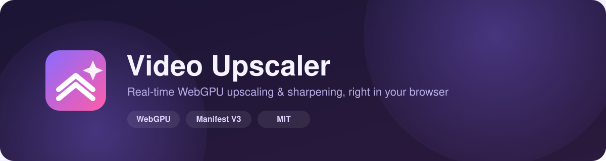

<div align="center">



<br>

[](LICENSE)


[](https://github.com/ThaminduMiuranda/anime-upscaler-webgpu/commits/main)
[](https://github.com/ThaminduMiuranda/anime-upscaler-webgpu/stargazers)

**Upscales and sharpens line art on any `<video>` element, live, entirely on your GPU — no server, no uploads.**

</div>

---

## ✨ Features

<table width="100%">
<tr>
<td width="33%" valign="top">

### 🖥️ Real-time GPU pipeline
A 5-pass WebGPU pipeline (denoise → upscale → edge detect → warp-sharpen → present) runs every frame, synced via `requestVideoFrameCallback`.

</td>
<td width="33%" valign="top">

### 🎛️ Tunable per-site
Denoise, edge-smoothing, line-tightening, line-darkening and sharpen are all independent sliders, plus Fast / Balanced / Quality presets.

</td>
<td width="33%" valign="top">

### 🔍 Split-screen compare
Toggle a live before/after split with `Alt+Shift+C` to see exactly what the upscaler is changing.

</td>
</tr>
<tr>
<td width="33%" valign="top">

### 🔒 Privacy-first
No network requests anywhere in the extension. Frames never leave your GPU — nothing is uploaded, logged, or tracked.

</td>
<td width="33%" valign="top">

### 🪶 Minimal permissions
Requests only `storage` for your settings. No host permissions, no analytics, no remote code.

</td>
<td width="33%" valign="top">

### ⚡ Works everywhere
Runs on any `<video>` across the open web — attaches automatically, skips DRM and cross-origin video safely.

</td>
</tr>
</table>

---

## 🚀 Quick Start

| | |
|---|---|
| **1. Clone** | `git clone https://github.com/ThaminduMiuranda/anime-upscaler-webgpu.git` |
| **2. Open extensions** | Go to `chrome://extensions` |
| **3. Enable Dev Mode** | Toggle **Developer mode** (top right) |
| **4. Load unpacked** | Click **Load unpacked** → select the cloned folder |
| **5. Play a video** | Open any site with video — the upscaler attaches automatically |

> Chrome Web Store listing: *coming soon.*

---

## ⌨️ Keyboard Shortcuts

| Shortcut | Action |
|---|---|
| `Alt+Shift+U` | Toggle upscaling on/off |
| `Alt+Shift+C` | Toggle split-screen before/after compare |

---

## 🎚️ Presets

| Preset | Denoise | Edge Smoothing | Line Tightening | Line Darkening | Sharpen |
|---|---|---|---|---|---|
| **Fast** | 0% | 0% | 0% | 0% | 35% |
| **Balanced** *(default)* | 25% | 60% | 50% | 15% | 35% |
| **Quality** | 40% | 85% | 80% | 30% | 45% |

Every slider can also be adjusted individually from the popup for a fully custom look.

---

## 🧠 How it works

```
video frame → prep (denoise) → upscale (edge-directed Catmull-Rom) → edges (Sobel)
            → warp (line-tightening + darkening) → present (adaptive sharpen) → canvas
```

Each stage is a full-screen WGSL fragment shader. The video frame is bound as a zero-copy
`texture_external` where supported, with an `ImageBitmap` copy fallback for GPUs that can't
import external video textures directly.

---

## 🛠️ Development

```bash
# Regenerate icons (requires Pillow)
pip install pillow
python tools/generate_icons.py
```

| Path | Purpose |
|---|---|
| `src/background.js` | Service worker — keyboard shortcuts, toolbar badge |
| `src/content.js` | Finds videos, manages per-video overlay controllers |
| `src/renderer.js` | WebGPU device + render pipeline |
| `src/shaders.js` | WGSL shaders for the upscaling pipeline |
| `src/settings.js` | Shared defaults, presets, normalization |
| `popup/` | Toolbar popup UI |

---

<div align="center">

Licensed under the [MIT License](LICENSE).

</div>
